 

 

 

## field log

**I'm Adib** — Hatiya Island → Dhaka College · HSC 2027 · Science (Physics · Chemistry · Math · English · Statistics). Golden A+ in SSC 2025. Now chasing **GOLDEN A+ in HSC** and a seat in **BUET CSE**.

I write code the way I crossed the river — one line at a time. Frontend first, backend and automation on the side.

<b>right now</b>

- 📘 **HSC 2027** — Physics · Chemistry · Math · English · Statistics (4th subject)
- 🛠 **building** — `agentic-sync` · `dchall` (Dhaka College Hall) · `dcsc` (DC Science Club) · voicetyping
- 🎯 **target** — Golden A+ → BUET CSE (fall 2027 / Jan 2028 admission)

 

 

 

## projects

| project | what it is | where |
|---|---|---|
| **agentic-sync** | multi-agent sync engine experiment | [github](https://github.com/seadib/agentic-sync) |
| **dchall** | Dhaka College Hall — official hall web platform | [live](https://dchall.netlify.app) |
| **dcsc** | Dhaka College Science Club portal | [live](https://dhakacollegescienceclub.github.io) |
| **voicetyping** | voice-to-type tool | [github](https://github.com/seadib/voicetyping) |
| **adi.pro.bd** | my corner of the web | [portfolio](https://adi.pro.bd) |
| **seadib.blogspot.com** | articles, notes, dev writeups | [blog](https://seadib.blogspot.com) |
| **drsahitto.blogspot.com** | literature & creative writing | [blog](https://drsahitto.blogspot.com) |

 

&nbsp;

 

